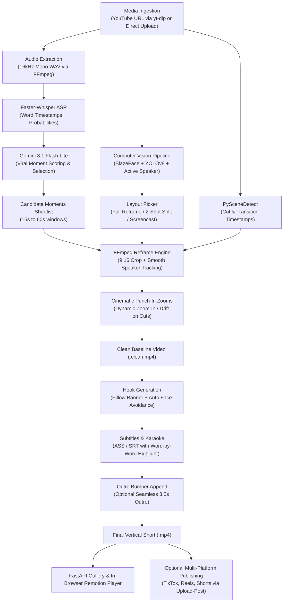

# ClipKraft (OpenShorts) — Complete Architectural & Feature Mental Model (`brain.md`)

> **Single Source of Truth**: This document contains the end-to-end mental model, system architecture, feature catalog, pipeline mechanics, and exact code references for the **ClipKraft** (formerly OpenShorts) codebase. Reading this file gives any engineer or AI agent full context of the entire project.

---

## 📑 Table of Contents

1. [Executive Overview & Mental Model](#1-executive-overview--mental-model)
2. [End-to-End Pipeline & System Flowchart](#2-end-to-end-pipeline--system-flowchart)
3. [Core Operational Modes](#3-core-operational-modes)
4. [Master Feature Catalog & Code Reference Map](#4-master-feature-catalog--code-reference-map)
   - [4.1 Media Ingestion & Video Download](#41-media-ingestion--video-download)
   - [4.2 Audio Extraction, Transcription & Speech Analysis](#42-audio-extraction-transcription--speech-analysis)
   - [4.3 AI Moment Detection & Virality Scoring](#43-ai-moment-detection--virality-scoring)
   - [4.4 Computer Vision, Active Speaker & 9:16 Reframing](#44-computer-vision-active-speaker--916-reframing)
   - [4.5 Multi-Scene Layouts & Dynamic Transitions](#45-multi-scene-layouts--dynamic-transitions)
   - [4.6 Cinematic Visual Retention & Punch Zooms](#46-cinematic-visual-retention--punch-zooms)
   - [4.7 Animated Subtitles & Karaoke Engine](#47-animated-subtitles--karaoke-engine)
   - [4.8 Viral Hook Banners & Graphic Overlays](#48-viral-hook-banners--graphic-overlays)
   - [4.9 B-Roll Insertion & Visual Storytelling](#49-b-roll-insertion--visual-storytelling)
   - [4.10 AI Dubbing & Multi-Language Translation](#410-ai-dubbing--multi-language-translation)
   - [4.11 Advanced Long-Form Composition Editor](#411-advanced-long-form-composition-editor)
   - [4.12 Thumbnail Studio & Packaging Suite](#412-thumbnail-studio--packaging-suite)
   - [4.13 SaaShorts — AI UGC & Virtual Actor Studio](#413-saasshorts--ai-ugc--virtual-actor-studio)
   - [4.14 Autopilot — Automated Channel Pipeline](#414-autopilot--automated-channel-pipeline)
   - [4.15 Social Media Publishing & Multi-Platform Analytics](#415-social-media-publishing--multi-platform-analytics)
   - [4.16 Model Context Protocol (MCP) Server for AI Agents](#416-model-context-protocol-mcp-server-for-ai-agents)
5. [Cloud SaaS, Billing & Platform Infrastructure](#5-cloud-saas-billing--platform-infrastructure)
6. [Frontend Architecture & In-Browser Remotion Player](#6-frontend-architecture--in-browser-remotion-player)
7. [Job Concurrency, Failure Handling & Process Lifecycle](#7-job-concurrency-failure-handling--process-lifecycle)
8. [Configuration, Environment Variables & Security Model](#8-configuration-environment-variables--security-model)
9. [Developer Quick Reference & Cheat Sheet](#9-developer-quick-reference--cheat-sheet)

---

## 1. Executive Overview & Mental Model

### What is ClipKraft?
**ClipKraft** is an AI-powered autonomous vertical video creation engine that takes long-form horizontal videos (podcasts, interviews, video essays, screencasts, gameplay) and transforms them into high-retention 9:16 vertical shorts optimized for **YouTube Shorts, TikTok, and Instagram Reels**.

### Dual-Deployment Architecture
ClipKraft ships as two complementary editions sharing the same core engine:
1. **Self-Hosted / BYOK (Bring Your Own Key)**:
   - Zero billing barriers; creator provides their Google Gemini API key (free tier supported).
   - Local storage, SQLite cache, full privacy, no watermarks, unlimited processing.
2. **Cloud SaaS (`cloud/`)**:
   - Full multi-tenant SaaS with passwordless Magic Links, Google OAuth, Stripe subscription billing, per-minute usage metering, retention save offers, and a GDPR account erasure workflow.
   - Free tier serves watermarked preview files (`wm_*`), which are instantly clean-unmarked upon plan upgrade.

### Core Architectural Invariants
1. **Clean Video Baseline Preservation**: Every clip extracted is permanently retained in its clean, unburned state (`.clean.mp4`). Subtitles, hooks, and effects are layered non-destructively, allowing instantaneous restyling in the UI without re-cutting or quality degradation.
2. **Process Isolation**: CPU/GPU-intensive video pipelines run in decoupled child subprocesses (`main.py`, `manual_clip_worker.py`) to prevent FastAPI event loop starvation.
3. **Dual Import Resolution**: Every internal package supports both root-level imports (`import subtitles`) and absolute package imports (`from backend.pipeline import subtitles`).

---

## 2. End-to-End Pipeline & System Flowchart



---

## 3. Core Operational Modes

| Mode | Purpose | Target User | Entry Point |
| :--- | :--- | :--- | :--- |
| **1. Open-Shorts (AI Mode)** | Fully automated AI pipeline: video in, viral shorts out with zero manual work. | Creators wanting hands-off content repurposing. | `POST /api/process` (`app.py`), `main.py` |
| **2. Edit Video (Manual Mode)** | Precise creator control over custom timestamps, viral hook text, 1.20x speedup, and outro bumpers. | Editors with predetermined clip moments. | `POST /api/manual-clip/process`, `ManualClipTab.jsx` |
| **3. Edit Full Video (Longform)** | Full-length multi-track timeline editing with non-destructive EDL, B-roll search, and transcript navigation. | Long-form creators, podcasters, educators. | `backend/api/edit_projects.py`, `LongVideoEditor.jsx` |
| **4. Autopilot Mode** | Continuous background daemon monitoring YouTube channels to auto-generate & schedule shorts. | Agencies, active brands, automated channels. | `cloud/autopilot.py`, `AutopilotTab.jsx` |
| **5. SaaShorts (AI UGC)** | Generate marketing shorts from scratch using Fal.ai virtual actors, synthesized voices, and product URLs. | SaaS founders, marketers, advertisers. | `backend/services/saasshorts.py`, `SaaShortsTab.jsx` |
| **6. Thumbnail Studio** | AI YouTube thumbnail generator pairing OCR titles with visual frame scoring. | YouTubers optimizing CTR. | `backend/pipeline/thumbnail.py`, `ThumbnailStudio.jsx` |

---

## 4. Master Feature Catalog & Code Reference Map

### 4.1 Media Ingestion & Video Download
* **Purpose**: Ingests video from YouTube URLs, direct web links, or user file uploads safely without hitting bot gates or running out of disk space.
* **How It Works**:
  - Uses `yt-dlp` configured with specialized client profiles (iOS, Android, Web Safari) and rotating user-agents to prevent IP bans.
  - Multi-tier proxy rotation: Direct connection → Static ISP proxies (`STATIC_PROXY_URLS`) → Metered per-GB proxy (`PROXY_URL`).
  - SSRF protection blocks requests to internal IP addresses (e.g., `10.0.0.0/8`, `127.0.0.1`, `169.254.169.254`).
  - File chunk streaming handles multi-gigabyte uploads gracefully.
* **Code References**:
  - `app.py`: `upload_video_chunk`, `_download_youtube_video`, `probe_video_duration`
  - `backend/utils/yt_clients.py`: Client profile spoofing and yt-dlp option builders
  - `backend/utils/restoring_static.py`: Proxy rotation and fallback logic
  - `backend/utils/security_utils.py`: `is_safe_url`, `validate_upload_path` (SSRF defense)
  - `backend/services/s3_uploader.py`: Syncing source files and job artifacts to AWS S3 / Cloudflare R2
* **Frontend**: `dashboard/src/components/MediaInput.jsx`

---

### 4.2 Audio Extraction, Transcription & Speech Analysis
* **Purpose**: Converts audio to text with millisecond-accurate word-level timestamps and speech probabilities.
* **How It Works**:
  - FFmpeg extracts 16kHz mono 16-bit PCM WAV.
  - Uses `faster-whisper` (CTranslate2 implementation of Whisper) for 4x faster GPU/CPU inference.
  - Generates word-level dictionaries containing `word`, `start`, `end`, and `probability`.
  - Computes root-mean-square (RMS) audio energy curves to identify speech intensity peaks.
* **Code References**:
  - `backend/pipeline/transcribe_backends.py`: `transcribe_with_whisper`, `transcribe_with_parakeet`
  - `backend/services/longform_transcribe.py`: Streaming word-level transcription for full-length sources
  - `backend/pipeline/ffmpeg_utils.py`: `extract_audio_for_transcription`
* **Frontend**: `dashboard/src/components/LongformTranscript.jsx`

---

### 4.3 AI Moment Detection & Virality Scoring
* **Purpose**: Discovers the most engaging, self-contained 15–60s segments from an hours-long video transcript.
* **How It Works**:
  - Slides a ~90-second scoring window across the transcript with overlap.
  - Prompts Google Gemini 3.1 Flash-Lite (or configurable LLM backend) with structured heuristics:
    1. **Hook Strength (0–10)**: Immediate curiosity or bold statement in the first 3 seconds.
    2. **Story Arc / Pacing (0–10)**: Clear setup, escalating tension or insight, and satisfactory conclusion.
    3. **Stand-Alone Value (0–10)**: Does it make complete sense without watching the rest of the video?
  - Scores are weighted and deduplicated; overlapping candidate clips are pruned.
  - **Silent Footage Fallback**: Detects gameplay (e.g., GTA V), b-roll, or music-only segments where speech is absent, falling back to visual scene-energy and cut density.
* **Code References**:
  - `backend/pipeline/clip_selection.py`: `get_viral_clips`, `score_transcript_window`, `deduplicate_clips`
  - `backend/pipeline/selection_quality.py`: Pacing heuristics and boundary refinement
  - `backend/services/gemini_worker.py`: Direct Google GenAI API communication
  - `backend/services/llm_backend.py`: Multi-provider LLM abstraction layer
* **Frontend**: `dashboard/src/components/ResultCard.jsx`, `ProcessingAnimation.jsx`

---

### 4.4 Computer Vision, Active Speaker & 9:16 Reframing
* **Purpose**: Dynamically reframes 16:9 horizontal video into 9:16 vertical video while keeping the talking speaker centered.
* **How It Works**:
  - **Face Detection**: Uses Google MediaPipe Tasks Vision (`blaze_face_short_range.tflite`) with YOLOv8 fallback.
  - **Active Speaker Tracking**: Combines lip movement bounding-box dynamics with audio speech energy to identify which face is currently talking.
  - **Smooth Camera Panning**: Applies an exponential moving average (EMA) Kalman filter to bounding-box coordinates to eliminate jitter and create smooth cinematic camera pans.
* **Code References**:
  - `backend/pipeline/reframe_v2.py`: `reframe_video_yolo`, `track_faces_and_bodies`
  - `backend/pipeline/active_speaker.py`: `detect_active_speaker`, `correlate_lip_motion_with_audio`
  - `backend/pipeline/frame_sampler.py`: Keyframe extraction for rapid visual analysis
* **Frontend**: `dashboard/src/components/ReframeEditor.jsx`

---

### 4.5 Multi-Scene Layouts & Dynamic Transitions
* **Purpose**: Selects optimal vertical layouts based on scene content (e.g., podcast dialogue vs presentation vs monologue).
* **How It Works**:
  - **Full Reframe**: Single subject centered with smart tracking.
  - **2-Shot Split (Split-Screen)**: Top-and-bottom stacked layout for interviews/podcasts, showing Host on top and Guest on bottom.
  - **Screencast / Slide Layout**: Screen content occupying upper 65% with presenter in a rounded circular or pill picture-in-picture (PIP) inset.
  - **Layout Transitions (`layout_ranges.py`)**: Seamlessly switches layouts mid-clip as scene composition changes.
* **Code References**:
  - `backend/pipeline/layout_picker.py`: `classify_scene_layout`
  - `backend/pipeline/split_layout.py`: `render_split_screen`
  - `backend/pipeline/screencast_layout.py`: `render_screencast_layout`
  - `backend/pipeline/camera_inset.py`: Picture-in-picture round webcam positioning
  - `backend/pipeline/layout_ranges.py`: Timeline-based layout boundary management
* **Frontend**: `dashboard/src/components/ReframeEditor.jsx`, `RemotionPreview.jsx`

---

### 4.6 Cinematic Visual Retention & Punch Zooms
* **Purpose**: Prevents viewer drop-off by applying subtle procedural camera zooms and cut punch-ins.
* **How It Works**:
  - **Punch-In Zooms**: Detects sentence transitions and scene cuts, instantly punching in 1.12x–1.20x to emphasize key statements.
  - **Camera Drift**: Continuous, subtle slow zoom-in or zoom-out (0.05% scale per frame) to maintain subconscious visual movement.
  - Integrates with PySceneDetect to place zoom transitions precisely on visual scene cuts.
* **Code References**:
  - `backend/pipeline/punch_in.py`: `apply_punch_in_zooms`
  - `backend/pipeline/scene_detection.py`: `detect_scene_boundaries`
  - `backend/pipeline/editor.py`: Vision effects coordination
* **Frontend**: `dashboard/src/remotion/compositions/VideoEffects.tsx`

---

### 4.7 Animated Subtitles & Karaoke Engine
* **Purpose**: Creates highly styled, animated, word-by-word highlighted captions that boost mobile retention.
* **How It Works**:
  - Generates ASS (Advanced SubStation Alpha) subtitle files with precision word overrides (`{\k...}`).
  - **Animation Presets**:
    - **Hormozi**: Bold uppercase font with bright yellow active-word pop and heavy black border.
    - **Pill**: Active word wrapped in an opaque rounded colored pill.
    - **One Word**: High-speed, single-word center pop.
    - **Clean**: Elegant sans-serif typography with subtle drop shadow.
    - **Lime Box**: Vibrant green highlight box.
    - **TikTok / Reels**: Platform-native subtitle styling.
  - **Full Positioning Controls**:
    - Vertical: `top`, `middle`, `bottom`
    - Horizontal Position: 0% to 100% slider with automatic diagonal tilt offset.
  - **Burn & Non-Destructive Restyling**: Renders via FFmpeg `libass`. Clean video is preserved so restyling takes seconds.
* **Code References**:
  - `backend/pipeline/subtitles.py`: `generate_ass`, `generate_srt`, `AUTO_CAPTION_STYLE`, ASS style generator
  - `backend/pipeline/burned_subtitles.py`: FFmpeg `ass=` filter burning execution
  - `app.py`: `/api/subtitle`, `/api/subtitle/remove`, `_burn_caption_style`
  - `dashboard/src/remotion/compositions/Subtitles.tsx`: In-browser live preview composition
* **Frontend**: `dashboard/src/components/SubtitleModal.jsx`

---

### 4.8 Viral Hook Banners & Graphic Overlays
* **Purpose**: Grabs attention in the first 3.0 seconds with a bold headline banner.
* **How It Works**:
  - Formulates catchy hooks based on 21 proven viral headline frameworks.
  - Validates hooks against the spoken transcript (`hook_grounding.py`) to avoid hallucinated clickbait.
  - Renders multi-line text boxes using Pillow with high-contrast text and solid background boxes.
  - **Smart Placement**: Analyzes face bounding boxes and caption regions to position the hook where it never obscures faces or captions.
  - Full horizontal (0–100%) and vertical positioning controls.
* **Code References**:
  - `backend/pipeline/hooks.py`: `add_hook_to_video`, `render_hook_image`
  - `backend/pipeline/hook_grounding.py`: Fact-checking hook text against transcript
  - `backend/pipeline/hook_placement.py`: Face & caption collision detection
  - `app.py`: `/api/hook`
  - `dashboard/src/remotion/compositions/HookOverlay.tsx`: In-browser hook preview
* **Frontend**: `dashboard/src/components/HookModal.jsx`

---

### 4.9 B-Roll Insertion & Visual Storytelling
* **Purpose**: Overlays relevant stock video footage (B-Roll) during voiceovers to illustrate concepts.
* **How It Works**:
  - Extracts key visual nouns and verbs from transcript segments.
  - Queries stock video search engines (Pexels, Pixabay).
  - Automatically scales, crops, and blends B-Roll footage over the main video with audio ducking.
* **Code References**:
  - `backend/pipeline/broll.py`: B-Roll placement and video layering
  - `backend/services/broll_search.py`: Stock API integration and caching
  - `backend/api/edit_composition.py`: `/api/edit-projects/{id}/broll/analyze`
* **Frontend**: `dashboard/src/components/LongVideoEditor.jsx`

---

### 4.10 AI Dubbing & Multi-Language Translation
* **Purpose**: Translates video speech into 29+ languages with cloned voice timbre.
* **How It Works**:
  - Transcribes and translates transcript text into the target language.
  - Leverages ElevenLabs Dubbing API / Speech-to-Speech API to synthesize natural sounding dubbed audio.
  - Mixes dubbed audio track with original background music/effects using FFmpeg sidechain ducking.
* **Code References**:
  - `backend/pipeline/translate.py`: `dub_video_elevenlabs`, language mapping
  - `app.py`: `GET /api/translate/languages`, `POST /api/translate`
* **Frontend**: `dashboard/src/components/TranslateModal.jsx`

---

### 4.11 Advanced Long-Form Composition Editor
* **Purpose**: Non-destructive timeline and EDL editor for full-length videos.
* **How It Works**:
  - Operates on a pure JSON Edit Decision List (EDL) model.
  - Tracks cuts, audio levels, b-roll overlays, and text layers without re-encoding until export.
  - Uses SQLite (`projects.sqlite3`) for transactional versioning, undo/redo histories, and occurrence maps.
  - Integrates YouTube Retention curves to visualize viewer drop-off points directly along the editor timeline.
* **Code References**:
  - `backend/pipeline/edit_project.py`: Core EDL data models
  - `backend/pipeline/longform_compositor.py`: Multi-track compositor
  - `backend/pipeline/longform_render.py`: High-performance FFmpeg export pipeline
  - `backend/api/edit_projects.py` & `backend/api/edit_composition.py`: Full REST API suite
  - `backend/services/youtube_retention.py`: YouTube Analytics drop-off mapping
* **Frontend**: `dashboard/src/components/LongVideoEditor.jsx`, `LongformTranscript.jsx`

---

### 4.12 Thumbnail Studio & Packaging Suite
* **Purpose**: Generates high-CTR YouTube thumbnail candidates and title ideas.
* **How It Works**:
  - Extracts candidate keyframes across the video at 1024px.
  - Gemini Vision analyzes facial expression intensity, visual clarity, and focal point quality.
  - Generates 25 high-CTR titles based on transcript insights and thumbnail imagery.
  - Allows composite text sticker overlay and preview before publishing.
* **Code References**:
  - `backend/pipeline/thumbnail.py`: `extract_candidate_frames`, `generate_thumbnail_titles`, `rate_thumbnail_frames`
  - `app.py`: `/api/thumbnail/upload`, `/api/thumbnail/titles`, `/api/thumbnail/generate`
* **Frontend**: `dashboard/src/components/ThumbnailStudio.jsx`

---

### 4.13 SaaShorts — AI UGC & Virtual Actor Studio
* **Purpose**: Automatically generates viral talking-head marketing shorts for software products from a URL.
* **How It Works**:
  - Analyzes a SaaS landing page URL to extract the core value proposition, problem, and solution.
  - Generates an energetic 30s TikTok UGC script.
  - Uses Fal.ai to generate video of a hyper-realistic virtual actor speaking the script.
  - Synthesizes voice and renders the final short complete with B-roll product screenshots and captions.
* **Code References**:
  - `backend/services/saasshorts.py`: `generate_actor_video`, `synthesize_saas_script`
  - `app.py`: `/api/saasshorts/generate`, `/api/saasshorts/actor-upload`, `/api/saasshorts/status`
* **Frontend**: `dashboard/src/components/SaaShortsTab.jsx`, `UGCGallery.jsx`

---

### 4.14 Autopilot — Automated Channel Pipeline
* **Purpose**: Completely hands-free YouTube channel automation.
* **How It Works**:
  - Polling worker regularly checks a creator's YouTube channel for new video uploads.
  - Automatically triggers the OpenShorts pipeline when a new video drops.
  - Scores generated shorts and queues the top-scoring clips into the social scheduler.
* **Code References**:
  - `cloud/autopilot.py`: `poll_channels_for_new_uploads`, `enqueue_autopilot_job`
* **Frontend**: `dashboard/src/components/AutopilotTab.jsx`

---

### 4.15 Social Media Publishing & Multi-Platform Analytics
* **Purpose**: One-click posting and scheduling to YouTube Shorts, TikTok, and Instagram Reels.
* **How It Works**:
  - Integrates with the Upload-Post API to handle authentication tokens, rate limits, and scheduling queues.
  - Creators can set a 7-day social calendar (e.g., post 1 Short per day at 6 PM).
  - Collects post impressions, view counts, and engagement analytics across platforms.
* **Code References**:
  - `app.py`: `/api/social/post`, `/api/social/analytics`, `/api/social/scheduled`
  - `backend/utils/social_metrics.py`: Platform metric aggregation
* **Frontend**: `dashboard/src/components/ScheduleWeekModal.jsx`, `SocialAnalyticsCard.jsx`

---

### 4.16 Model Context Protocol (MCP) Server for AI Agents
* **Purpose**: Allows external AI agents (Claude Desktop, Antigravity, Cursor) to control ClipKraft as a native tool.
* **How It Works**:
  - Implements the Model Context Protocol over both HTTP/SSE (`mcp_server.py`) and standard input/output (`mcp_stdio.py`).
  - Exposes tools: `process_video`, `get_job_status`, `list_clips`, `edit_clip`, `generate_subtitles`, `add_hook`.
  - Supports OAuth 2.0 authorization server (`cloud/mcp_oauth.py`) for secure external agent authentication.
* **Code References**:
  - `backend/api/mcp_server.py`: SSE transport and tool schema registration
  - `backend/api/mcp_stdio.py`: Stdio transport for local CLI agent integration
  - `cloud/mcp_oauth.py`: OAuth client registration and token exchange
* **Frontend**: `dashboard/src/components/McpConnectCard.jsx`

---

## 5. Cloud SaaS, Billing & Platform Infrastructure

The `cloud/` package turns the core video engine into a full-fledged SaaS platform:

```text
cloud/
├── account.py         # GDPR account deletion & data purging
├── api_keys.py        # Developer API key generation & validation
├── auth.py            # Passwordless magic links & session JWTs
├── autopilot.py       # Automated YouTube channel ingest daemon
├── billing.py         # Stripe checkout, subscriptions, and webhooks
├── cancellation.py    # Retention save offers & offboarding survey
├── config.py          # Cloud environment settings & feature flags
├── database.py        # SQLAlchemy database models & session factory
├── digest.py          # Email notification digests
├── managed_keys.py    # Fallback platform API keys pool
├── marketing.py       # Unsubscribe and email preference management
├── mcp_oauth.py       # Model Context Protocol OAuth server
├── metering.py        # Processed video duration quota tracker
├── oauth.py           # Google OAuth 2.0 login integration
├── proxy_ledger.py    # Real-time proxy bandwidth accounting
├── social_profiles.py # Upload-Post social accounts link
└── storage.py         # Managed S3 / R2 storage quotas
```

### Key Subsystems:
1. **Quota Wall & Top-Ups (`TopUpModal.jsx`, `metering.py`)**:
   - Triggers HTTP 402 when a user attempts to process video longer than their plan's remaining minutes.
   - Allows instant one-off top-up minute purchases via Stripe checkout without upgrading tier.
2. **Free Tier Watermarking (`watermarked.py`)**:
   - Free users have their exports rendered with a semi-transparent corner watermark (`assets/watermark.png`).
   - Clean, non-watermarked videos are preserved internally; the moment a user upgrades to a paid plan, watermarks are removed without re-rendering.
3. **Retention Flow (`cancellation.py`)**:
   - When a user initiates cancellation, an exit survey analyzes their pain points and automatically offers an instant 50% discount save offer before canceling.

---

## 6. Frontend Architecture & In-Browser Remotion Player

The frontend (`dashboard/`) is a high-performance Single Page Application (SPA) built with **React 18**, **Vite**, and **TailwindCSS**:

### In-Browser Remotion Player (`dashboard/src/remotion/`)
Instead of forcing a heavy FFmpeg server re-render every time a user changes a font, color, or subtitle position, ClipKraft embeds a live **Remotion Player** directly in the browser:
- `HookOverlay.tsx`: Real-time preview of text hooks, animations, and coordinates.
- `Subtitles.tsx`: Word-by-word karaoke typography rendering that matches the server's ASS output 1:1.
- `ShortVideo.tsx`: Full composite video player previewing cuts, reframes, and effects.

### SEO & Public Landing Surface (`dashboard/vite-plugin-seo.js`)
- Renders build-time static HTML pages for crawlers without needing SSR infrastructure.
- Generates `sitemap.xml`, `robots.txt`, and `llms.txt` automatically from `dashboard/seo/data.js`.

---

## 7. Job Concurrency, Failure Handling & Process Lifecycle

### Concurrency Model
- Managed by an async semaphore in `app.py`, bounded by `MAX_CONCURRENT_JOBS` (default: 5).
- Jobs transition through states: `QUEUED` → `DOWNLOADING` → `TRANSCRIBING` → `SCORING` → `REFRAMING` → `COMPLETED` / `FAILED`.

### Process Isolation & Recovery
- Video rendering is delegated to separate OS processes via `subprocess.Popen([sys.executable, "main.py", ...])`.
- If a child process crashes (e.g., OOM in PyTorch), the parent FastAPI server detects the exit code, marks the job failed with detailed error diagnostics, and recovers memory cleanly.
- Jobs and artifacts are automatically purged after **7 days (604,800 seconds)** by a background cleanup loop.

---

## 8. Configuration, Environment Variables & Security Model

### Essential Environment Variables (`.env`)

| Variable | Description | Default |
| :--- | :--- | :--- |
| `GEMINI_API_KEY` | Google Gemini API key for viral scoring & OCR | Required for AI mode |
| `GEMINI_MODEL` | Gemini model identifier | `gemini-3.1-flash-lite` |
| `MAX_CONCURRENT_JOBS` | Maximum simultaneous video processing jobs | `5` |
| `PORT` | Backend server port | `8000` |
| `RETENTION_SECONDS` | Job and video artifact retention window | `604800` (7 days) |
| `BILLING_ENABLED` | Toggle Cloud SaaS mode (Stripe, Auth) | `false` |
| `STRIPE_SECRET_KEY` | Stripe API key for billing | Optional |
| `ELEVENLABS_API_KEY` | ElevenLabs API key for AI dubbing | Optional |
| `UPLOAD_POST_API_KEY`| Social publishing API key | Optional |
| `FAL_KEY` | Fal.ai API key for SaaShorts virtual actors | Optional |
| `S3_BUCKET` / `R2_BUCKET`| Cloud storage bucket for artifact backups | Optional |

### Security Invariants
- **SSRF Protection**: `backend/utils/security_utils.py` blocks private IPv4 and loopback domains on all URL download routes.
- **Android Keystore Protection**: Keystore and signing files are strictly protected read-only assets; never regenerated.
- **Zero Plaintext Credentials**: All keys are loaded from environment variables or encrypted local configs.

---

## 9. Developer Quick Reference & Cheat Sheet

### Common Commands

```powershell
# 1. Start full stack with Docker Compose
docker compose up --build

# 2. Run Backend Standalone (FastAPI)
pip install -r requirements.txt
uvicorn app:app --host 0.0.0.0 --port 8000 --reload

# 3. Run Frontend Standalone (Vite + React)
cd dashboard
npm install
npm run dev

# 4. Run Automated Test Suite (108 test suites)
pytest tests/ -v

# 5. Run OpenShorts CLI directly
python cli/openshorts_cli.py process "https://www.youtube.com/watch?v=..."
```

---
*Created as the foundational engineering reference for ClipKraft (OpenShorts).*
