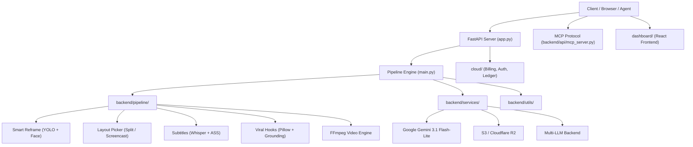

# ClipKraft Architecture & Folder Structure

This document outlines the organized modular architecture of **ClipKraft** (formerly OpenShorts), detailing the separation of concerns across the backend video processing pipeline, API services, cloud billing, and dashboard interface.



---

## Directory Layout

```text
ClipKraft/
├── app.py                      # FastAPI server & async job orchestrator
├── main.py                     # CLI & per-job pipeline execution runner
│
├── backend/                    # Core Python backend architecture
│   ├── __init__.py             # Root backend package & path resolution
│   ├── api/                    # API protocols & streaming auth
│   │   ├── mcp_server.py       # MCP protocol endpoint (HTTP/SSE)
│   │   ├── mcp_stdio.py        # MCP stdio runner for AI desktop clients
│   │   ├── mcp_ui.py           # MCP UI tool helpers
│   │   └── media_auth.py       # Media stream access control
│   │
│   ├── pipeline/               # Video processing, computer vision, & layouts
│   │   ├── active_speaker.py   # Speaker mouth-movement detection
│   │   ├── burned_subtitles.py # FFmpeg subtitle burn filter
│   │   ├── camera_inset.py     # Picture-in-picture talking head
│   │   ├── clip_selection.py   # AI viral moment scoring & ranking
│   │   ├── edit_builder.py     # Edit instruction generator
│   │   ├── editor.py           # Gemini vision effects & smart zoom
│   │   ├── ffmpeg_utils.py     # FFmpeg wrappers & video probes
│   │   ├── frame_sampler.py    # Representative frame extraction
│   │   ├── hook_grounding.py   # Hook transcript validation
│   │   ├── hook_placement.py   # Hook timeline & visual placement
│   │   ├── hooks.py            # Hook graphics generator (Pillow)
│   │   ├── layout_picker.py    # Vision layout classifier
│   │   ├── layout_ranges.py    # Multi-scene layout transitions
│   │   ├── panel_layout.py     # Multi-panel video layouts
│   │   ├── punch_in.py         # Dynamic camera punch zooms
│   │   ├── quality_probe.py    # Video quality probes & metrics
│   │   ├── recut.py            # Clip recutting & re-rendering
│   │   ├── reframe_v2.py       # YOLOv8 tracking & 9:16 reframe
│   │   ├── scene_detection.py  # PySceneDetect scene boundaries
│   │   ├── screencast_layout.py# Slides, UI, & screen recordings
│   │   ├── split_layout.py     # Two-shot split-screen layout
│   │   ├── subtitles.py        # Faster-Whisper, SRT, & ASS generator
│   │   ├── thumbnail.py        # Thumbnail Studio generator
│   │   ├── transcribe_backends.py # Whisper & Parakeet ASR models
│   │   ├── translate.py        # ElevenLabs AI dubbing & translation
│   │   └── watermarked.py      # Free tier watermark delivery
│   │
│   ├── services/               # External AI and cloud integrations
│   │   ├── gemini_worker.py    # Google Gemini API connector
│   │   ├── llm_backend.py      # LLM provider abstraction layer
│   │   ├── saasshorts.py       # AI actor generation (fal.ai)
│   │   └── s3_uploader.py      # AWS S3 / Cloudflare R2 backup
│   │
│   └── utils/                  # Shared utility functions
│       ├── file_hosts.py       # Throwaway file host resolvers
│       ├── free_tools.py       # Public SEO tools helpers
│       ├── log_view.py         # Job log streaming & formatting
│       ├── restoring_static.py # Static proxy fallback & rotation
│       ├── security_utils.py   # SSRF & URL security validation
│       ├── social_metrics.py   # Social engagement collector
│       └── yt_clients.py       # yt-dlp client profiles & spoofing
│
├── cloud/                      # Cloud SaaS (Auth, Stripe, Ledger, Quota)
├── dashboard/                  # React + Vite frontend application
├── remotion/                   # Motion graphics & Remotion components
├── render-service/             # Node.js Remotion rendering microservice
├── scripts/                    # Verification & maintenance utilities
├── tests/                      # Automated test suite (67 test modules)
├── docs/                       # Architectural documentation & media
└── fonts/                      # Bundled typography & fontconfig assets
```

---

## Architectural Principles

1. **Separation of Concerns**: Pipeline algorithms (reframing, cutting, detection) are decoupled from server routes (`app.py`), cloud billing (`cloud/`), and UI (`dashboard/`).
2. **Dual-Resolution Module System**: All backend modules can be imported directly (e.g. `import subtitles`) or via their qualified package path (e.g. `from backend.pipeline import subtitles`), maintaining backward compatibility with tests and child processes.
3. **Container-Friendly Environment**: Docker containers and CI workflows inject `PYTHONPATH` encompassing all backend subdirectories, guaranteeing fast module resolution without path collision.
